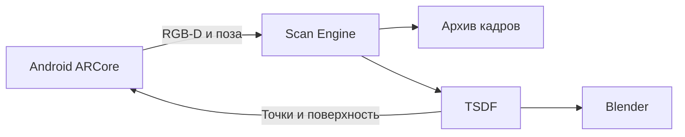

# Архитектура

**Android.** ARCore отвечает за tracking, позу и Raw Depth. GL-рендерер показывает текстуру камеры. На новом синхронном кадре приложение копирует плоскости CameraYUV, Raw Depth и confidence с учётом strides, затем JPEG-кодирование и атомарная запись идут в фоновом потоке. Приложение ограничивает частоту захвата и держит максимум одно измерение в очереди записи. Отправка читает подтверждаемые файлы с диска, JPEG используется как исходное цветное измерение для этого MVP. Глубина и confidence сохранены без потерь. Состояние (включая ACK) хранится отдельно от самих кадров.

**ПК.** FastAPI принимает измерения и валидирует метаданные и SHA-256. Пакет сохраняется до ACK. Один рабочий поток с очередью на 8 кадров владеет Open3D VoxelBlockGrid. Модуль fusion выдаёт накопленные цветные точки и TSDF mesh. Размер облака ограничен воксельной выборкой. Размер mesh снижается упрощением до бюджета предпросмотра. Геометрию можно получить через протокол независимо от реализации ядра. CLI replay работает из сохранённых пакетов и принимает JSON уточнённых поз.

**Blender.** Фоновый поток опрашивает HTTP, обрабатывает ответы и скачивает экспорт. Таймер bpy выполняет ограниченные обновления mesh, а точки и траекторию рисует viewport GPU. Импорт завершённой модели выполняет штатный оператор Blender. Параметры экспорта и визуализации доступны в панели N.

## Согласование координат

ARCore даёт физическую позу камеры (локальные +X вправо, +Y вверх, −Z вперёд). Представление пакета — матрица Camera-to-World 4×4 row-major, метры. В Pinhole-проекции CV +X вправо, +Y вниз, +Z вперёд. `CV_TO_AR=diag(1,-1,-1,1)`. Поворот ARCore мира в Blender Z-up — `(x,y,z) -> (x,-z,y)`. Поэтому `T = AR_TO_BLENDER * T_arcore * CV_TO_AR`. Обе операции имеют определитель +1. Open3D получает `T⁻¹`, PLY сохраняет координаты Blender Z-up, а GLB хранит Y-up по glTF. Проекция и метрический масштаб проверяются синтетическим тестом.

Глубина ориентирована как исходная GPU-текстура. Intrinsics масштабируются из `Camera.getTextureIntrinsics()` в разрешение глубины. Для регистрации с RGB используется преобразование ARCore `TEXTURE_NORMALIZED → IMAGE_PIXELS` и три угла текстуры. RGB JPEG в нативной ориентации; экранная ориентация кадра определяется отдельно. См. [официальный пример ARCore](https://github.com/google-ar/arcore-android-sdk/tree/main/samples/raw_depth_java).

Сеанс принимает только TRACKING и свежие кадры `Frame.timestamp == rawDepth.timestamp`. Для confidence и CPU RGB тоже требуется совпадающая метка. Физическое совпадение временных меток и точность RGB-регистрации на целевом телефоне остаются частью аппаратной проверки. Если производитель использует другую проверяемую связь меток, её нужно измерить и описать в новой версии протокола перед ослаблением условия.

Настройки начинают с вокселя 20 мм, усечения 80 мм, confidence 96 из 255, глубины 0,5–3 м, интеграции до 10 Гц и mesh до 1 Гц. Извлечение может занимать дольше заданного периода. Android и Blender используют одну систему координат данных и независимые видовые проекции.
